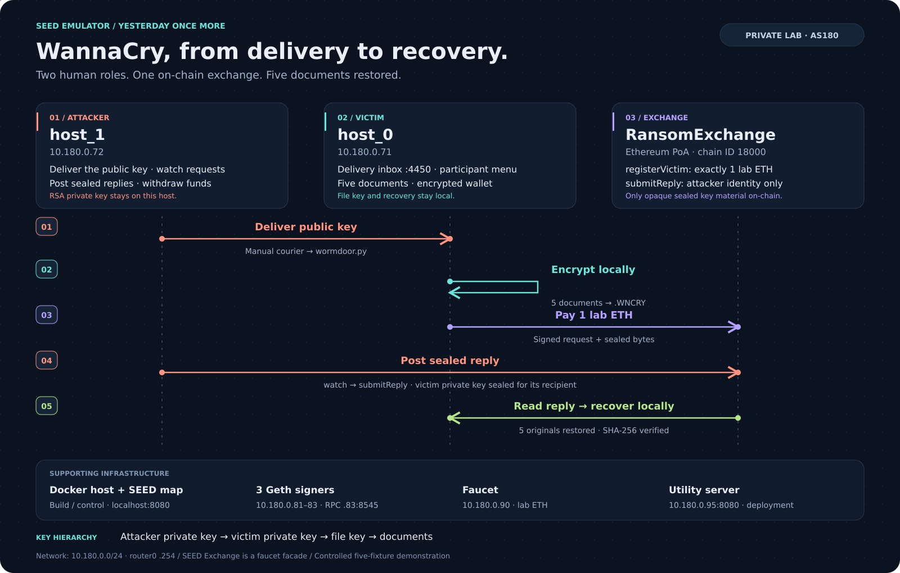

# WannaCry Incident Lab (Y04_wannacry/v2)

A WannaCry-style ransomware scenario on the SEED Emulator where every mechanism
is real: RSA-2048 + AES-256-GCM file encryption, a real private Ethereum PoA
chain (Geth, chain ID 18000), a real deployed `RansomExchange` smart contract,
and real signed transactions. Humans play the attacker and the victim on two
separate hosts; the smart contract enforces what the original incident did
manually over BTC + TOR.

## The incident, in one line

The attacker delivers a payload to the victim workstation, documents are
encrypted into `<name>.WNCRY` envelopes, the victim creates a wallet, buys lab
ETH on the in-menu "SEED Crypto Exchange", pays the enforced 1-ETH ransom
on-chain, and recovers all documents with their original names after the
attacker replies on-chain — every recovered file verified against its
pre-attack SHA-256 baseline.

## Topology (AS180, 10.180.0.0/24)

| Node | Address | Role |
|---|---|---|
| host_0 | 10.180.0.71 | victim workstation: documents, ransom note, participant menu, delivery inbox (:4450) |
| host_1 | 10.180.0.72 | attacker machine: `init-attacker`, `deliver`, `watch`, `withdraw` |
| chain0/1/2 | 10.180.0.81–.83 | Geth PoA signers; RPC on .83:8545 |
| faucet | 10.180.0.90 | lab ETH dispenser |
| utility | 10.180.0.95:8080 | deploys `RansomExchange` at boot; serves address + attacker account |
| router0 | 10.180.0.254 | network gateway |

### Architecture for demos

Open [the interactive architecture walkthrough](diagrams/architecture.html) in
any browser. It works offline: use **← / →** to step through the five stages,
**O** for the overview, and **F** for fullscreen. This is an illustrative
presentation, independent of the running lab.



For slides, use the [SVG](diagrams/architecture.svg) or
[PNG](diagrams/architecture.png). The [PlantUML source](architecture.puml)
provides the detailed component view.

Regenerate the SVG and self-contained HTML after editing their source:

```bash
python3 diagrams/render_architecture.py
```

To refresh the optional PNG export (requires CairoSVG):

```bash
cairosvg diagrams/architecture.svg -o diagrams/architecture.png -s 2
```

## Key design facts

- **Key hierarchy** (never change without discussion):
  `attacker_priv` (born on host_1, never leaves) → sealed `victim_priv`
  (posted on-chain as an inert blob) → file key (never leaves the victim) →
  files. The reply carries **only** `victim_priv`; the victim unseals its own
  file key locally. The per-request ephemeral X25519 keypair protects the
  reply channel; the Ethereum wallet key signs only, never encrypts.
- **The chain carries only opaque sealed bytes.** Enforcement is in the EVM:
  `registerVictim` requires exactly 1 lab ETH; `submitReply` is attacker-only.
- **Encrypted-file format**: `Y04LAB1\n | nonce(12) | ciphertext | tag(16)`,
  participant id + filename authenticated as AES-GCM associated data.
- **`wormdoor.py`** on host_0 is the worm's drop point played by hand — a
  courier stand-in, not the exploit. Real propagation will replace it.
- Fixed to the five generated fixtures (`file_generator.py`); a reversible
  lab demonstration, not a general file encryptor.

## Run it

```bash
# compile (needs python3.10 + PYTHONPATH=/path/to/chain-seed:/path/to/seed-emulator)
python3 emulator.py --override
cd output && docker compose build && docker compose up -d
```

Then follow **`RUNBOOK.md`** — the master operator walkthrough with every
command, expected output, and a troubleshooting table.

## File map

| File | Role |
|---|---|
| `emulator.py` | blueprint: AS180 router + two hosts; bakes lab files and boots `wormdoor` |
| `lab_chain.py` | private chain layer: 3 Geth nodes, faucet, utility server, contract deploy |
| `contracts/RansomExchange.sol` (+ `compile_contract.py`) | the enforced ransom contract; offline solc 0.8.20, evm_version=london |
| `lab_keylogic.py` | payload brain: key hierarchy, sealing, exchange protocol, CLI |
| `lab_ransom_chain.py` | on-chain transport: hand-computed selectors + eth-account signing, no web3 |
| `lab_wallet.py` | encrypted keystore, balance queries, faucet funding |
| `wormdoor.py` | victim delivery inbox (:4450): drops the pub key, detonates the payload |
| `file_generator.py` / `prepare_participant.py` | the 5 fixtures + SHA-256 baseline (`participant.json`) |
| `participant.py` / `terminal_ui.py` | the participant menu: inspect [2], SEED Exchange [3], pay/recover [5], wallet [6] |
| `check_state.py` | one-shot read-only status (run this first when debugging) |
| `PARTICIPANT_README.txt` | the in-host ransom note |
| `MANUAL_RUNBOOK.txt` | the same actions without the menus |
| `RUNBOOK.md` | master operator runbook (start here) |
| `architecture.puml` | detailed component diagram (PlantUML) |
| `diagrams/architecture.html` | offline, keyboard-controlled demo walkthrough |
| `diagrams/architecture.svg` / `.png` | presentation diagram for docs and slides |
| `diagrams/render_architecture.py` | standard-library source for SVG + HTML |
| `MEMORY.md` | agent memory: design decisions, bug ledger, proven state |
| `tests/` | unit tests: `python -m unittest discover -s tests` from this directory |

## Scope and future work

Deliberately out for now: real exploit/propagation (replaces the `wormdoor`
courier), one-attacker-to-many-victims across networks at scale (the contract
and `watch` already support N requests), and per-request payment gating.
